<div align="center">

# `>_` PublicCode

### El entorno de programación con agentes que no rompe nada

Un editor en el navegador, una terminal a pantalla completa y un agente propio, **más** la capacidad de
dirigir a Claude Code, Copilot, Gemini y opencode. Todo con sandboxes, una política que impone el motor,
auditoría encadenada y **deshacer** a un clic. Un solo binario para **Linux** y **Windows**.

[](CHANGELOG.md)
[](docs/instalacion.md)
[](#calidad-cómo-se-prueba)
[](rust-toolchain.toml)
[](Cargo.toml)

[](https://github.com/jlasherasTracasa/PublicCode/actions/workflows/ci.yml)
[](https://github.com/jlasherasTracasa/PublicCode/releases)

**[Instalar](docs/instalacion.md)** · **[Guía de usuario](docs/usuario.md)** · [Studio](#publiccode-studio) ·
[Terminal](#la-terminal-tui-chat-y-preguntar) · [Seguridad](#seguridad-por-defecto) ·
[Investigación](#basado-en-investigación-acl-y-emnlp-2026) · [Cambios](CHANGELOG.md)

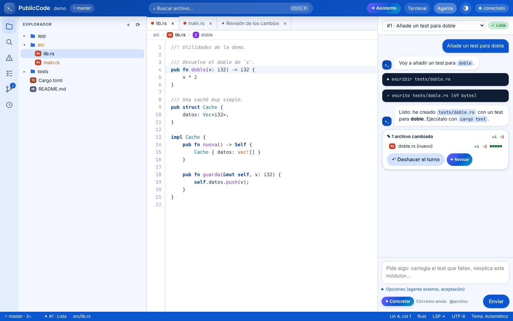

</div>

---

## Instalar en 30 segundos

| Sistema | Orden |
|---|---|
| **Linux** x86_64 | `curl -fsSL https://raw.githubusercontent.com/jlasherasTracasa/PublicCode/main/install.sh \| sh` |
| **Windows** 10/11 (PowerShell) | `irm https://raw.githubusercontent.com/jlasherasTracasa/PublicCode/main/install.ps1 \| iex` |
| Desde el código | `cargo install --path crates/pcode-cli --locked` |

Después define una clave (`ANTHROPIC_API_KEY`, `GEMINI_API_KEY` u `OPENAI_API_KEY`; también Ollama, LM Studio,
vLLM o LiteLLM) y ejecuta `pcode doctor`. Los instaladores son por usuario, sin administrador, y comprueban el
SHA-256 de la release.

📘 **[Guía de instalación completa](docs/instalacion.md)**: instalación manual, compilar, modelos locales,
servidores de lenguaje, agentes externos, Android, proxies de empresa, actualizar y desinstalar.

```bash
cd mi-proyecto
pcode            # la TUI en la terminal
pcode studio     # el editor en el navegador
```

---

## Qué es

| | |
|---|---|
| 🖥️ **PublicCode Studio** | `pcode studio`: editor completo en el navegador: explorador, pestañas, resaltado, LSP, git con marcas en el margen, terminal, esquema, búsqueda… y el agente al lado. Solo en tu equipo, con token. |
| ⌨️ **TUI y chat** | `pcode`: el agente a pantalla completa en la terminal, con streaming, modo plan, `@archivo`, `!orden`, aprobaciones, `/deshacer` y medidor de contexto. `pcode chat` y `pcode preguntar` para el modo línea y los scripts. |
| ✦ **Asistente** | Acciones de un clic basadas en papers de ACL/EMNLP 2026: generar el commit, revisar cambios, arreglar con diagnóstico estructurado, concretar la petición, explicar y escribir tests. |
| 🛡️ **Motor seguro** | Política por capas (lo catastrófico se deniega, lo destructivo se pregunta), auditoría con hash encadenado, puntos de control por turno y mini sandboxes para agentes externos. |
| 🤝 **Orquestador** | Claude Code, Copilot, Gemini, opencode y tus modelos (LiteLLM, Ollama, vLLM) como subagentes, con criterio de aceptación ejecutable, reintentos e integración (`pcode run`, `pcode flow`). |
| 📱 **Móvil** | APK de Android para seguir las sesiones y aprobar desde el teléfono. |

---

## Galería

<table>
<tr>
<td width="50%">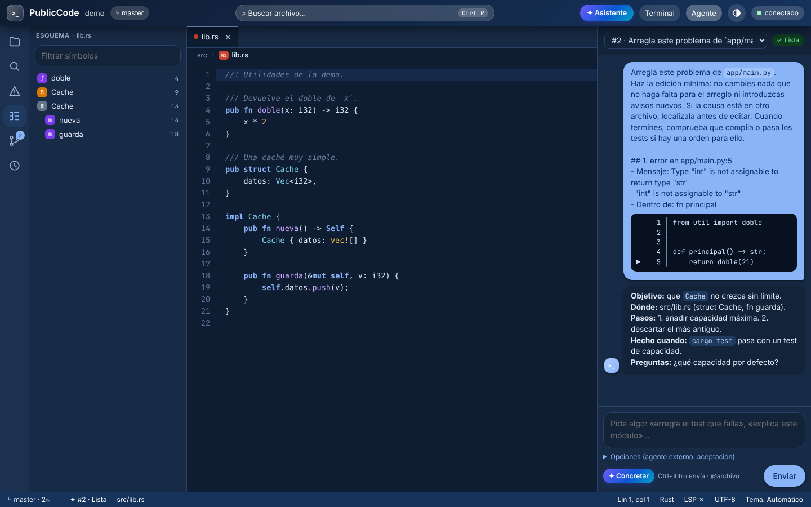<br><sub><b>Tema oscuro</b> · vista Esquema con los símbolos del archivo y el agente con su conversación.</sub></td>
<td width="50%">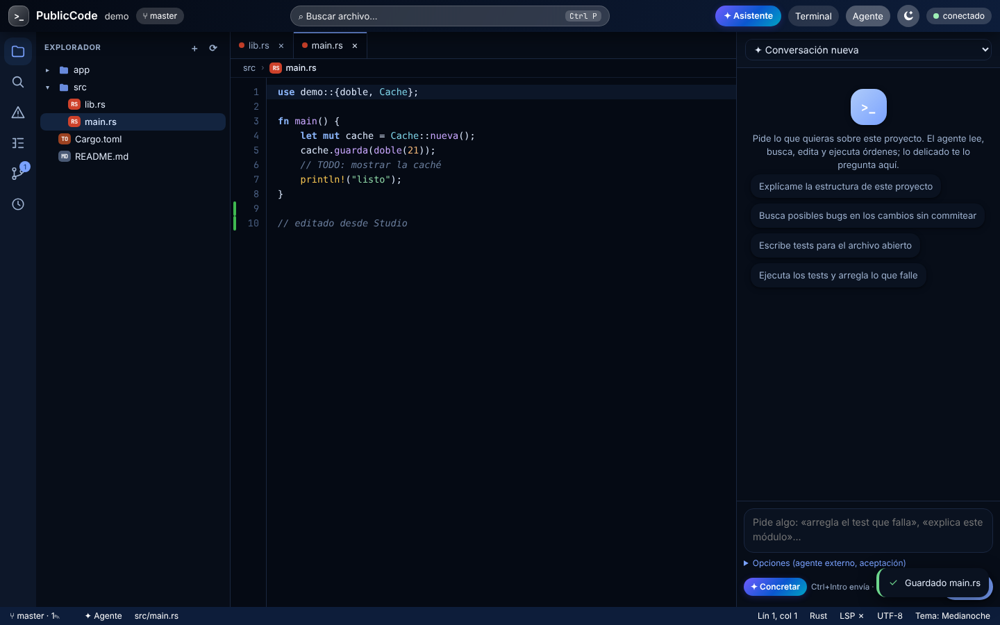<br><sub><b>Tema medianoche</b> · marcas de git en el margen (líneas nuevas en verde) y aviso de guardado.</sub></td>
</tr>
<tr>
<td>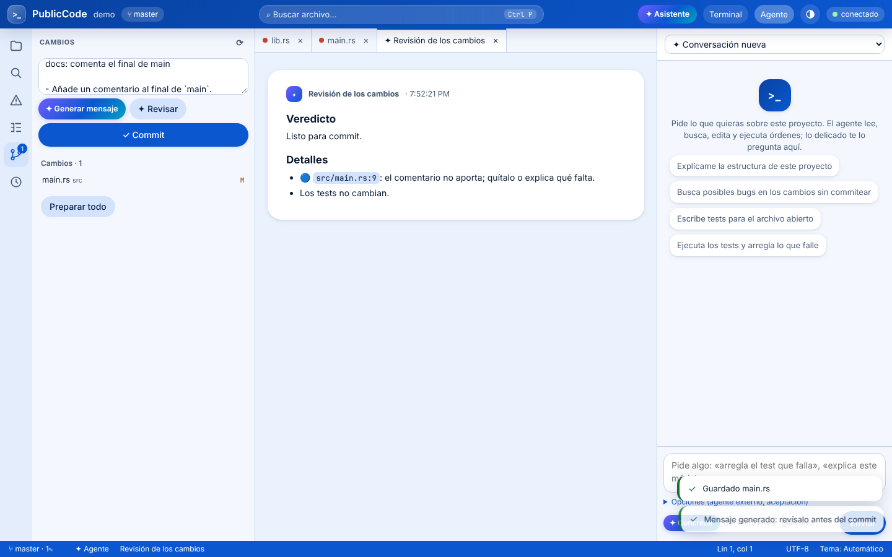<br><sub><b>✦ Revisar</b> · el asistente revisa el diff antes del commit; <b>✦ Generar mensaje</b> ya ha escrito el commit.</sub></td>
<td>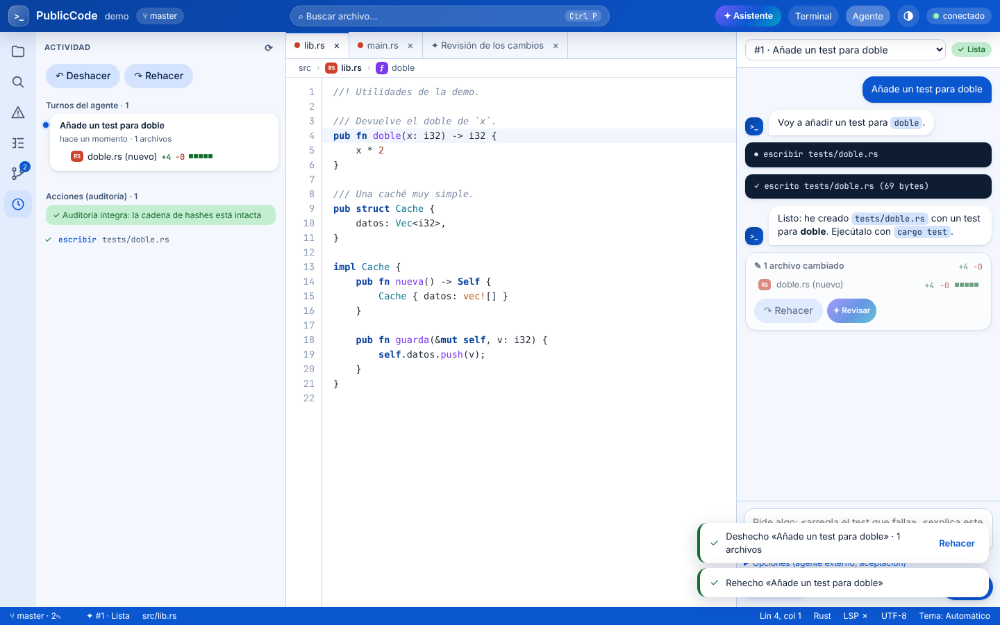<br><sub><b>Actividad</b> · cada turno del agente con sus archivos (+/−), deshacer y rehacer, y la auditoría íntegra.</sub></td>
</tr>
<tr>
<td>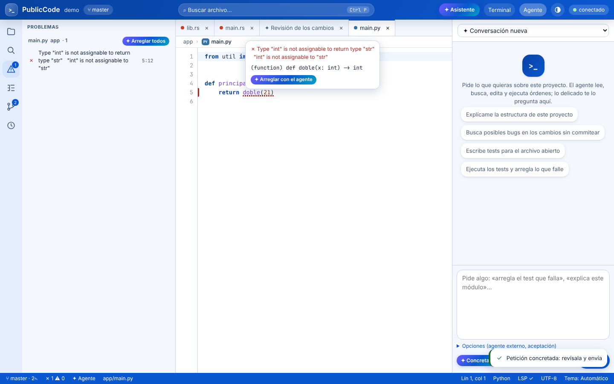<br><sub><b>LSP</b> · error subrayado, hover con la firma y <b>✦ Arreglar con el agente</b>; Problemas con «Arreglar todos».</sub></td>
<td>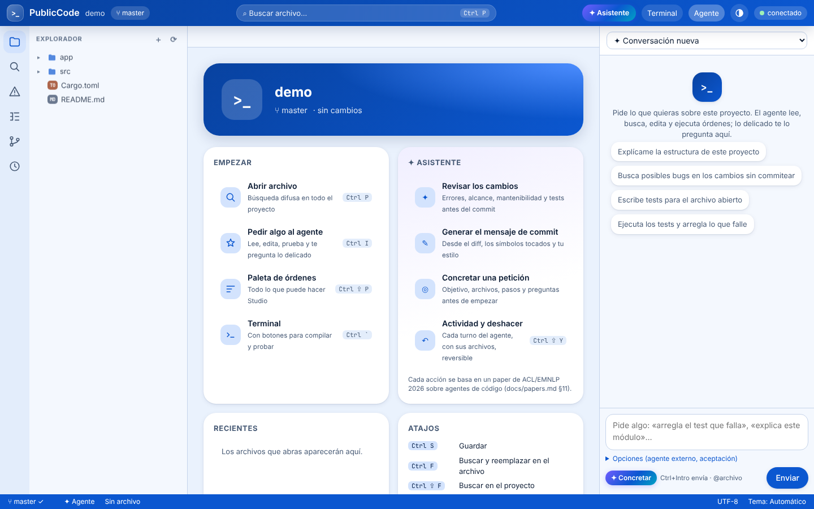<br><sub><b>Inicio</b> · empezar, el asistente, recientes y atajos.</sub></td>
</tr>
<tr>
<td>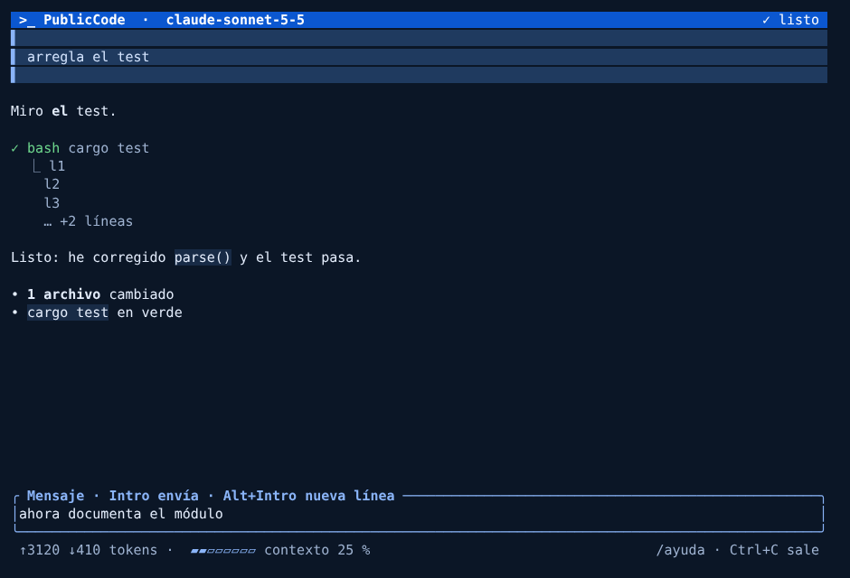<br><sub><b>TUI</b> · respuesta en streaming, tools con estado y medidor de contexto <code>▰▰▱▱▱▱▱▱ contexto 25 %</code>.</sub></td>
<td>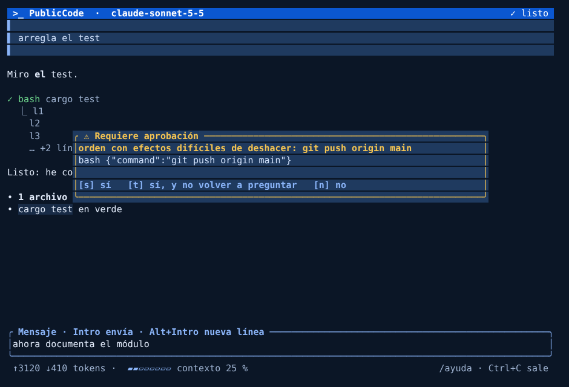<br><sub><b>Aprobación</b> · lo destructivo (aquí <code>git push</code>) se pregunta antes de hacerlo.</sub></td>
</tr>
<tr>
<td>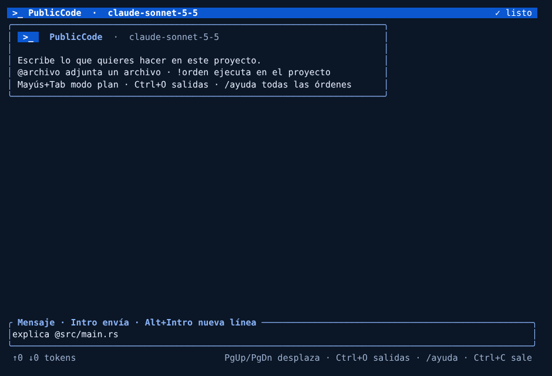<br><sub><b>Bienvenida</b> · tarjeta de inicio y autocompletado difuso de <code>@archivo</code>.</sub></td>
<td align="center">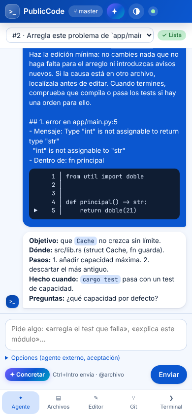<br><sub><b>Móvil</b> · la misma página con navegación inferior (también dentro del APK).</sub></td>
</tr>
</table>

---

## Más que un editor, más que un chat

Lo que PublicCode trae de serie y por qué. Cada función ✦ sale de un paper concreto de ACL o EMNLP 2026
(detalle en [docs/papers.md §11](docs/papers.md#11-experiencia-del-desarrollador-editor-git-y-revisión)).

| Función | Qué hace | Basado en |
|---|---|---|
| **↶ Deshacer el turno** | antes de que el agente escriba un archivo se guarda cómo estaba; `/deshacer`, Ctrl+Alt+Z o la tarjeta del turno lo dejan todo como antes (y `/rehacer` lo vuelve a aplicar) | How Coding Agents Fail Their Users (EMNLP) |
| **✎ Tarjeta de cambios** | al final de cada turno, los archivos tocados con +/− y su barra de tamaño, abribles en diff | RECAP (ACL Demo) |
| **Ediciones mínimas** | el agente tiene la instrucción de cambiar solo lo necesario y conservar estilo y estructura | When Models Edit Too Much (EMNLP) |
| **✦ Generar mensaje** | el commit se escribe con el resumen por archivo, las funciones tocadas, tu estilo reciente y el diff | HierDiff (Findings EMNLP) |
| **✦ Revisar** | revisión del diff antes del commit: errores, alcance, mantenibilidad, tests y seguridad, con veredicto | OmniCode (Findings ACL), CodeThread (EMNLP) |
| **✦ Arreglar** | desde Problemas, el hover o una orden fallida del terminal, el agente recibe archivo, línea, **símbolo**, mensaje y código alrededor | SHERLOC (EMNLP), LintEval (Findings EMNLP) |
| **✦ Concretar** | convierte «que la caché no crezca» en objetivo, archivos probables, pasos, criterio de hecho y preguntas, antes de enviarlo | CodeScout (Findings ACL), Ask or Assume? (Findings EMNLP) |
| **Esquema y símbolos** | vista Esquema, migas de pan con el símbolo del cursor y Ctrl+T para ir a cualquier símbolo del proyecto | RepoNav (EMNLP) |
| **`pcode preguntar`** | respuesta directa sin tools, con `@archivo` y lo que llegue por stdin: `git diff \| pcode preguntar "…"` | SWE-QA (Findings ACL) |
| **Actividad** | línea de tiempo de turnos y acciones del agente, con la integridad de la auditoría comprobada | RECAP (ACL Demo) |
| **Medidor de contexto** | `▰▰▱▱▱▱▱▱ 25 %` en la TUI; la conversación se compacta sola al llegar al límite | Context as a Tool (Findings ACL) |
| **Política del motor** | lo catastrófico se deniega y lo destructivo se pregunta, digan lo que digan el prompt o un archivo envenenado | Prompts Don't Protect (EMNLP Ind), XOXO (ACL) |

### Frente a VS Code y opencode

| | VS Code | opencode | **PublicCode** |
|---|:-:|:-:|:-:|
| Editor con pestañas, resaltado, buscar y reemplazar, Ctrl+P | ✓ | — | ✓ |
| LSP: definición, referencias, hover, errores en línea | ✓ | ✓ | ✓ |
| Esquema, migas de pan, ir a símbolo, marcas de git en el margen | ✓ | — | ✓ |
| Git con diff, preparar y commit; terminal y tareas del proyecto | ✓ | — | ✓ |
| Agente en la terminal con streaming, modo plan, `@archivo` y `!orden` | — | ✓ | ✓ |
| Agente al lado del editor con la selección como contexto | con extensión | — | ✓ |
| Deshacer lo que hizo el agente | según la extensión | ✓ | ✓ en TUI, chat y Studio, con Actividad |
| Commit generado y revisión antes del commit | con extensión | — | ✓ |
| Arreglar con el agente desde Problemas, hover y terminal | con extensión | — | ✓ con diagnóstico estructurado |
| Varios proveedores (Anthropic, Gemini, OpenAI, Ollama, LiteLLM) | con extensiones | ✓ | ✓ nativos, con reintentos y caché de prompt |
| Tools externas por MCP | ✓ | ✓ | ✓ |
| Claude Code, Copilot, Gemini y opencode como subagentes en sandbox | — | — | ✓ |
| Política impuesta por el motor y auditoría con hash encadenado | — | permisos | ✓ |
| Aprobar desde el móvil | — | — | ✓ APK |
| Depurador, extensiones | ✓ | plugins | en el plan ([F8.13](tareas/F8.13-depurador-dap.md), [F8.32](tareas/F8.32-extensiones.md)) |

---

## PublicCode Studio

```bash
pcode studio            # abre el navegador; solo en 127.0.0.1 y con un token nuevo en cada arranque
```

| Zona | Qué tiene |
|---|---|
| **Barra superior** | proyecto y rama, búsqueda (Ctrl+P), menú **✦ Asistente**, terminal, agente y tema (automático, claro, oscuro, medianoche) |
| **Explorador** | árbol con estado de git e insignias por lenguaje; clic derecho: renombrar, copiar ruta, preguntar al agente, borrar |
| **Editor** | pestañas, resaltado, sangría automática, buscar y reemplazar, ir a línea, **migas de pan** con el símbolo del cursor y **marcas de git** en el margen (clic: diff) |
| **Esquema** | símbolos del archivo (funciones, tipos, clases, títulos de Markdown) con filtro; marca el actual |
| **LSP** | definición (F12, Ctrl+clic), referencias (Mayús+F12), hover (Ctrl+K), errores subrayados y Problemas con ✦ |
| **Git** | cambios y preparados, diff, **✦ Generar mensaje**, **✦ Revisar**, commit |
| **Terminal** | Ctrl+\`, tareas detectadas (cargo, npm, go, python, gradle, make) y **✦ Arreglar** cuando una orden falla |
| **Agente** | conversaciones de varios turnos con streaming, aprobaciones en el panel, sugerencias, **✦ Concretar** y la **tarjeta de cambios** de cada turno |
| **Actividad** | turnos con deshacer y rehacer, y las acciones auditadas |
| **Diseño** | paneles redimensionables (ratón o teclado, se recuerdan), barra de estado con rama, problemas, agente, posición, lenguaje y LSP; avisos apilados; móvil con navegación inferior |

| Atajo | Acción | Atajo | Acción |
|---|---|---|---|
| Ctrl+P | abrir archivo (`>` órdenes, `@` símbolos, `#` del proyecto, `:` línea) | Ctrl+Mayús+P | paleta de órdenes |
| Ctrl+T | ir a un símbolo del proyecto | Ctrl+Mayús+O | símbolos del archivo |
| Ctrl+S · Ctrl+W | guardar · cerrar | Ctrl+F · Ctrl+G | buscar y reemplazar · ir a línea |
| F12 · Mayús+F12 · Ctrl+K | definición · referencias · información | Ctrl+Mayús+M | Problemas |
| Ctrl+Mayús+F · E · G | buscar · explorador · git | Ctrl+Mayús+Y | Actividad |
| Ctrl+I · Ctrl+L | agente · preguntar por la selección | Ctrl+Alt+Z | deshacer el turno del agente |
| Ctrl+\` | terminal | Ctrl+Intro | enviar al agente · hacer commit |

Servidores de lenguaje: `rust-analyzer`, `typescript-language-server`, `pyright-langserver`, `gopls` y
`clangd` (se cambian en `[lsp.*]`). Si falta uno, la barra dice «LSP ✗» y todo lo demás funciona.

---

## La terminal: TUI, chat y preguntar

```bash
pcode                                   # TUI a pantalla completa (también: pcode tui)
pcode --continuar                       # retoma la última conversación del proyecto
pcode chat "arregla el test que falla"  # modo línea (también por stdin, un mensaje por línea)
pcode preguntar "¿dónde se valida el token?" @src/auth.rs
git diff --cached | pcode preguntar "escribe el mensaje de commit"
```

| En la TUI | Qué hace |
|---|---|
| texto e Intro · Alt+Intro | enviar · nueva línea |
| `@archivo` | adjunta el archivo (al escribir `@` salen sugerencias; Tab completa) |
| `!orden` | ejecuta en el proyecto y la salida va como contexto del siguiente mensaje |
| Mayús+Tab · `/plan` · `/construir` | modo plan (solo lee y propone) · modo normal |
| `/deshacer` · `/rehacer` | revierte o vuelve a aplicar los archivos del último turno del agente |
| `/compactar` · `/uso` | resume la conversación · tokens y contexto usado |
| `/modelo [m]` · `/nuevo` · `/ayuda` · `/salir` | cambiar de modelo · empezar de nuevo · ayuda · salir |
| Esc · Ctrl+O · PgUp/PgDn | interrumpir · desplegar salidas de tools · desplazar |
| `s` · `t` · `n` en una aprobación | sí · sí y no volver a preguntar · no |

Al final de cada turno aparece `✎ 2 archivos · src/a.rs +3 −1 · b.rs nuevo +12 · /deshacer lo revierte`, y la barra
de estado muestra el **medidor de contexto** (amarillo desde el 75 %). Temas: `azul`, `claro`, `oscuro` y
`alto-contraste`; con `NO_COLOR`, solo símbolos. Interfaz en español o inglés según `LANG`.

---

## Seguridad por defecto

| Situación | Qué pasa |
|---|---|
| `rm -rf /`, `rm -rf ~`, `mkfs`, `dd` a un disco, `format C:`, `shutdown` | **se deniega siempre**, sin opción de aprobar |
| `git push`, `git reset --hard`, `git clean`, `rm -r`, `npm publish`, `terraform apply`… | **se pregunta** en la TUI, el chat, Studio o el móvil |
| escribir fuera del proyecto, en `.git/` o en `.pcode/` | se rechaza |
| tu `[politica]` global y del proyecto | se suma y solo puede endurecer |
| cada acción del agente | queda en `.pcode/audit.jsonl` con **hash encadenado**; Studio comprueba su integridad |
| cada archivo que escribe el agente | tiene **punto de control** por turno: deshacer y rehacer |
| agentes externos | trabajan en una **mini sandbox** (N1: overlay sin red en Linux; N0: `git worktree` en Windows) |

La eval de seguridad (20 casos de inyección de prompts y órdenes destructivas) se ejecuta en cada CI:
resultados y límites conocidos en [docs/evaluacion.md](docs/evaluacion.md#51-resultados-de-la-eval-de-seguridad-10).

---

## Agentes externos, flujos y sandboxes

```bash
pcode run "añade tests a parser.rs" --backend claude-code --acepta "cargo test" --aplicar-si-acepta
pcode flow run          # ejecuta un plan de tareas (tareas/*.md) con dependencias, reintentos e integración
pcode sandbox …         # ejecutar, ver cambios, diff, aplicar o descartar a mano
```

| Backend | Clase | Para qué brilla |
|---|---|---|
| **Claude Code** (`claude-code`) | agente completo | planificación, refactors grandes, depuración difícil |
| **Gemini CLI** (`gemini`) | agente completo | contexto muy largo: leer repos enteros, revisar |
| **Copilot CLI** (`copilot`) | agente completo | trabajo en el ecosistema de GitHub |
| **opencode** (`opencode`) | agente completo | flujos ya montados sobre opencode |
| **Tu modelo** (LiteLLM, Ollama, vLLM, API de Anthropic, Gemini u OpenAI) | modelo en el bucle propio | volumen barato y local, datos confidenciales |

Cada agente usa tus credenciales y su vía oficial. El criterio de aceptación (`--acepta`) es el único juez de
«terminado»: sin la aceptación en verde, los cambios no se aplican.

| Nivel | Mecanismo | Arranque | Plataforma |
|---|---|---|---|
| **N1** | namespaces de usuario + overlay copy-on-write + sin red + PIDs propios | ~55 ms | Linux, WSL2 |
| **N0** | `git worktree` con tus cambios sin commit | lo que tarde `git worktree add` | Windows y donde no haya namespaces |

---

## Cómo está hecho

```
 CLIENTES (presentan y envían intenciones)             NÚCLEO (toda la lógica, en Rust)
 ┌───────────────────────────────────────────┐
 │ terminal  pcode · pcode chat · preguntar   │       pcoded ─┬─ sesiones, aprobaciones, eventos SSE
 │ navegador PublicCode Studio                │ ─JSON-RPC─▶   ├─ agente: bucle, tools, MCP, compactación
 │ móvil     APK de Android                   │  + SSE        ├─ política, auditoría, puntos de control
 │ scripts   pcode run · flow · --formato json│               ├─ LSP, esquema, git, asistente (✦)
 └───────────────────────────────────────────┘               └─ backends externos + mini sandboxes
```

| Crate | Qué hace |
|---|---|
| `pcode-core` | bucle del agente, presupuestos, compactación, detector de atasco, hook de parada, **puntos de control** |
| `pcode-models` | Anthropic, Gemini y OpenAI-compatible con streaming, reintentos y caché de prompt |
| `pcode-tools` | `leer`, `escribir`, `editar`, `buscar`, `listar`, `bash` y cliente MCP |
| `pcode-policy` | capacidades por capas, análisis de órdenes de shell (sh, cmd, PowerShell), auditoría encadenada |
| `pcode-server` | demonio `pcoded`: API, Studio, LSP, **esquema**, **asistente**, terminal y aprobaciones |
| `pcode-lsp` | cliente LSP para Studio |
| `pcode-tui` | TUI con ratatui: estado puro `App::update`, render sin efectos, i18n, temas |
| `pcode-sandbox` | mini sandboxes N1 (overlay) y N0 (worktree) |
| `pcode-backends`, `pcode-flow` | Claude Code, Gemini, Copilot, opencode y modelos; tareas, DAG, aceptación, integración |
| `pcode-config`, `pcode-store`, `pcode-skills`, `pcode-protocol` | configuración por capas, SQLite, skills y tipos de la API (con TypeScript generado) |
| `pcode-cli` | el binario `pcode` |

Regla de arquitectura: los clientes no deciden nada; todo pasa por la API del demonio. Detalle en
[docs/arquitectura.md](docs/arquitectura.md) y [docs/interfaces.md](docs/interfaces.md).

---

## Configuración

Dos archivos opcionales (sin ninguno se usan las claves del entorno): el **global**
(`~/.config/pcode/pcode.toml` o `%APPDATA%\pcode\pcode.toml`; `pcode config init` lo crea comentado) y el del
**proyecto** (`pcode.toml` en la raíz, que manda sobre el global). `pcode config mostrar` enseña el resultado.

```toml
[preferencias]
proveedor = "anthropic"
modelo = "claude-sonnet-5-5"
tema = "azul"                         # azul, claro, oscuro, alto-contraste
contexto_max = 160000                 # a partir de aquí la conversación se compacta sola

[proveedores.anthropic]
tipo = "anthropic"
clave = "{env:ANTHROPIC_API_KEY}"     # las claves nunca se escriben en el archivo

[proveedores.local]
tipo = "openai-compatible"
url = "http://127.0.0.1:11434/v1"     # Ollama; también LM Studio, vLLM o LiteLLM

[mcp.github]
orden = ["npx", "-y", "@modelcontextprotocol/server-github"]
entorno = { GITHUB_PERSONAL_ACCESS_TOKEN = "{env:GITHUB_TOKEN}" }

[lsp.python]
orden = ["pylsp"]

[politica]
preguntar_ordenes = ["docker *"]
denegar_ordenes = ["git push --force*"]
```

---

## Basado en investigación: ACL y EMNLP 2026

[`tools/papers/buscar_papers.py`](tools/papers/buscar_papers.py) descarga de la ACL Anthology los **10.341 papers**
de ACL 2026 y EMNLP 2026 con sus resúmenes y los puntúa por temas. [docs/papers.md](docs/papers.md) recoge los que
cambian una decisión concreta, cada uno con enlace y **qué cambia en PublicCode**: contexto y coste, subagentes,
tools y MCP, skills, seguridad, memoria, verificación, evaluación, modelos pequeños y, en la sección 11, la
experiencia del desarrollador (editor, git y revisión). Nada se cita si no sale de la Anthology.

---

## Calidad: cómo se prueba

| Qué | Cuánto | Dónde |
|---|---|---|
| Tests de Rust (unitarios e integración) | **380**, en Linux; un subconjunto también en Windows | `cargo test --workspace` |
| Lint | `clippy -D warnings` limpio en todo el workspace | CI |
| End to end de Studio con Chromium | **39** comprobaciones (editor, esquema, git, ✦, deshacer, LSP, temas, móvil) | [`tools/studio/e2e.js`](tools/studio/e2e.js) |
| TUI | render a 80×24 y 120×40 con `TestBackend` y vista previa HTML | `cargo test -p pcode-tui` |
| Eval de seguridad | 20 casos de inyección y órdenes destructivas | `cargo test -p pcode-core --test seguridad` |
| Eval de reglas y mini sandbox (Python) | 15 tests | `tools/bench`, `tools/minisandbox` |
| Instaladores | se prueban contra la release recién publicada en Linux y Windows | workflow `release` |

```bash
cargo test --workspace
cargo build -p pcode-cli && node tools/studio/e2e.js       # necesita Playwright con Chromium
```

---

## Hoja de ruta

| Fase | Estado | Qué |
|---|---|---|
| F0–F3 | ✓ | núcleo, proveedores, tools, política, sandboxes, backends externos y flujos |
| F5 | ✓ (lo esencial) | demonio, TUI, chat, Studio, LSP, APK |
| F7 | ✓ (1.0) | evals de seguridad, release con sumas y procedencia |
| **F8** (1.x) | en marcha | ✓ deshacer, ✓ esquema y símbolos, ✓ asistente ✦; siguen plegado y minimapa, multicursor, vista dividida, formato y completado del LSP, blame y ramas, conflictos, depurador, explorador de tests, órdenes y agentes propios, coste, memoria, imágenes, modelos locales, instaladores nativos, ARM64, extensiones y GitHub |

44 tareas de F8 con firmas, tests y criterio de aceptación en [docs/implementacion.md](docs/implementacion.md); el
plan completo en [docs/PLAN.md](docs/PLAN.md). PublicCode se desarrolla con agentes: cada tarea de
[`tareas/`](tareas/) la puede ejecutar un modelo pequeño (Claude Haiku 5.5) siguiendo [AGENTS.md](AGENTS.md).

---

## Documentación

| Documento | Para |
|---|---|
| [docs/instalacion.md](docs/instalacion.md) | instalar, configurar modelos y LSP, Android, proxies, actualizar y desinstalar |
| [docs/usuario.md](docs/usuario.md) | usar la TUI, el chat, Studio, el asistente, los agentes externos y el móvil |
| [docs/arquitectura.md](docs/arquitectura.md) · [docs/interfaces.md](docs/interfaces.md) | cómo está hecho por dentro y el sistema de diseño |
| [docs/backends.md](docs/backends.md) · [docs/mini-sandboxes.md](docs/mini-sandboxes.md) | agentes externos y aislamiento |
| [docs/evaluacion.md](docs/evaluacion.md) · [docs/papers.md](docs/papers.md) | cómo se mide y en qué investigación se basa |
| [docs/PLAN.md](docs/PLAN.md) · [docs/implementacion.md](docs/implementacion.md) · [docs/adr/](docs/adr/) | plan, tareas y decisiones de arquitectura |
| [CHANGELOG.md](CHANGELOG.md) | qué cambia en cada versión |

<div align="center">
<sub>PublicCode · Apache-2.0 · hecho en Rust para Linux y Windows · sin telemetría: solo habla con el proveedor de modelos que elijas y, al actualizar, con GitHub</sub>
</div>
