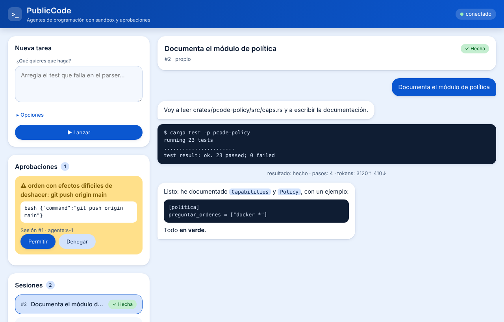
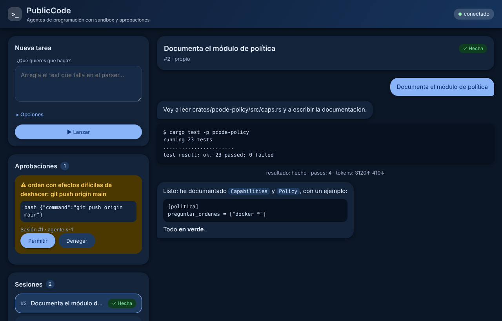

# PublicCode

**Programación agéntica con un equipo de agentes en lugar de uno solo.** PublicCode orquesta
**Claude Code**, **GitHub Copilot**, **Gemini** y **tus propios modelos servidos con LiteLLM**
(GLM, Qwen, vLLM, Ollama…) como subagentes intercambiables. Cada uno trabaja en su **mini sandbox**,
comparte las mismas **skills** y **tools** y responde ante un **criterio de aceptación ejecutable**.
Todo se audita y se mide.

Se usa desde donde trabajes: **terminal** (CLI para scripts y TUI interactiva), **aplicación de
escritorio** (Linux y Windows), **navegador**, **móvil** (aprobaciones), **IDE** (ACP, VS Code
y MCP) y **GitHub**. Todos son clientes del mismo demonio, así que una sesión empezada en la terminal
se sigue en el escritorio.

> **Versión 1.0** · 343 tests y `clippy -D warnings` limpio · [guía de usuario](docs/usuario.md) · [cambios](CHANGELOG.md).
> Funciona hoy:
>
> | Parte | Qué hay | Tareas |
> |---|---|---|
> | **LSP** | definición, referencias, hover, errores en línea y panel Problemas en Studio (rust-analyzer, TypeScript, pyright, gopls, clangd) | F5.35 |
> | **Windows sin WSL** | `--backend` y `pcode flow` con la sandbox N0 (`git worktree`) | F2.21 |
> | **Seguridad comprobada** | eval de 20 inyecciones y órdenes destructivas y eval de reglas, en cada CI | F7.02, F0.06 |
> | **Studio** | `pcode studio`: editor en el navegador con explorador, pestañas, resaltado de sintaxis, buscar/reemplazar, Ctrl+P, búsqueda en el proyecto, git (diff, preparar, commit), terminal integrada, tareas del proyecto y el agente al lado | F5.32 |
> | **Conversaciones** | las sesiones del demonio (web, Studio, APK) admiten varios turnos, streaming y aprobaciones (`pcode chat --formato jsonl`) | F5.33 |
> | **MCP** | tools externas por MCP (`[mcp.*]`, `pcode mcp`) con la misma política y auditoría | F2.22 |
> | **Modos** | modo plan (solo lee y propone), `@archivo` con autocompletado y `!orden` en la TUI y el chat | F5.34 |
> | **TUI** | `pcode`: interfaz a pantalla completa con el texto en streaming, tools con estado (`✓ ✗` y salida plegable con Ctrl+O), Markdown, aprobaciones en ventana, historial, desplazamiento y temas | F5.30 |
> | **Chat** | `pcode chat`: el mismo agente en modo línea (también por stdin), con `--continuar`, `/modelo` y Ctrl-C; detecta la clave del entorno | F5.29 |
> | Streaming | el texto llega token a token desde Anthropic, Gemini y OpenAI-compatible | F1.25 |
> | Robustez | reintentos ante 429/5xx/red, caché de prompt de Anthropic, compactación automática del contexto, política segura por defecto, configuración global y certificados del sistema | F1.26 |
> | Instalación | una línea en Linux (`curl … \| sh`) y Windows (`irm … \| iex`) con SHA-256; `pcode doctor`, `pcode config`, `pcode actualizar` | F0.08 |
> | Proveedores | Anthropic (Messages API), Gemini (`generateContent`) y OpenAI-compatible (LiteLLM, vLLM, Ollama, OpenAI) | F1.22, F1.23 |
> | Núcleo | bucle del agente con política (capacidades por capas, análisis de shell), auditoría con hash encadenado, presupuestos, hook de parada, detector de atasco, compresión de salidas; proveedores OpenAI-compatible (LiteLLM, vLLM, Ollama) con SSE y reparación de tool calls | F1.01–F1.21 |
> | Tools | `leer`, `escribir`, `editar`, `buscar`, `listar`, `bash` | F1.08–F1.12 |
> | Mini sandbox | overlay CoW sin privilegios, sin red, aplicar/descartar/diff, `pcode sandbox …` | F2.01–F2.03 |
> | Backends | Claude Code, Gemini CLI, Copilot CLI, opencode y modelo propio; `pcode run --backend X` | F2.06–F2.12, F2.18 |
> | Skills | registro, exportación a Claude/AGENTS/Copilot/Gemini/opencode, contratos | F2.13–F2.15 |
> | Flujos | tareas con criterio de aceptación, DAG, estado por eventos, planificador, integración sin conflictos de lockfile, clasificador de CI, `pcode flow run` | F3.01–F3.08, F3.10 |
> | Demonio | API JSON-RPC + eventos SSE + página web + cola de aprobaciones, tipos TypeScript generados, `pcode daemon` | F5.01–F5.03 |
> | Windows | el núcleo, `pcode run` y `pcode daemon` funcionan en Windows (shell `cmd`, política que entiende cmd y PowerShell); la sandbox N1 es solo de Linux | F1.24 |
> | CI/CD | CI en Linux y Windows con prueba de humo; release con `.zip` para Windows, `.tar.gz` para Linux, `.apk` para Android y `SHA256SUMS` | F0.07 |
> | Android | APK cliente del demonio (sesiones y aprobaciones en un WebView); `pcode daemon --escuchar` | F5.28 |
>
> **Pendiente**: de F0, la verificación de CLIs (F0.03), el banco (F0.04) y la eval de reglas (F0.06); de F2, el Copilot
> coding agent (F2.11) y `pcode run --backend` / `pcode flow` en Windows sin WSL (F2.21, nivel N0); de F3, el
> planificador LLM, la revisión cruzada, la etapa N2 de la aceptación y `pcode bench`; de F5, la API de flujos en el demonio (F5.04) y la TUI conectada al demonio con árbol de sesiones, panel de cambios, `@archivo` y atajos configurables (F5.07–F5.11; la TUI actual lleva el agente en el propio proceso). Además (en [docs/implementacion.md](docs/implementacion.md) figura como `pendiente`): Landlock y
> seccomp, proxy de salida y red filtrada, servidor MCP, TUI, UI React y app de
> escritorio, PWA, ACP, VS Code, GitHub, contexto/memoria/router (F4), aprendizaje de skills (F6) y
> endurecimiento (F7). Los adaptadores de CLIs de terceros usan fixtures sintéticas hasta que F0.03
> (verificación con las CLIs instaladas) aporte salidas reales.

---

## Índice

1. [Por qué existe](#por-qué-existe)
2. [Frente a opencode y VS Code](#frente-a-opencode-y-vs-code)
3. [Qué hace mejor que opencode](#qué-hace-mejor-que-opencode)
4. [Agentes y modelos que integra](#agentes-y-modelos-que-integra)
5. [Cómo funciona](#cómo-funciona)
6. [Interfaces: terminal, escritorio, web, móvil e IDE](#interfaces-terminal-escritorio-web-móvil-e-ide)
7. [Conceptos](#conceptos)
8. [Mini sandboxes](#mini-sandboxes)
9. [Skills compartidas entre todos los agentes](#skills-compartidas-entre-todos-los-agentes)
10. [Tools propias](#tools-propias)
11. [Políticas de seguridad aplicadas por el motor](#políticas-de-seguridad-aplicadas-por-el-motor)
12. [Base científica: ACL y EMNLP 2026](#base-científica-acl-y-emnlp-2026)
13. [Cómo se mide que es mejor](#cómo-se-mide-que-es-mejor)
14. [Hoja de ruta](#hoja-de-ruta)
15. [Instalación](#instalación)
16. [Uso rápido (lo que ya funciona)](#uso-rápido-lo-que-ya-funciona)
17. [Configuración](#configuración)
18. [Estructura del repositorio](#estructura-del-repositorio)
19. [Desarrollar PublicCode con agentes](#desarrollar-publiccode-con-agentes)
20. [Decisiones abiertas](#decisiones-abiertas)

---

## Por qué existe

Hoy cada agente de programación es una isla: Claude Code, Copilot, Gemini CLI y opencode tienen
fortalezas distintas, configuraciones distintas (`CLAUDE.md`, `.github/copilot-instructions.md`,
`GEMINI.md`, `AGENTS.md`) y ninguno de ellos sabe coordinar a los demás. Cuando un proyecto quiere
usarlos en serio acaba escribiendo su propio pegamento.

Lo que falta no es otro agente, sino lo que hay **alrededor**: tareas con criterio de aceptación,
verificación, reintentos que aprenden del fallo anterior, una cola de integración que no se rompe con
los lockfiles, reglas que el motor impone en lugar de pedirlas en un prompt, aislamiento barato para
cada subagente y una forma de medir si algo mejora. PublicCode convierte todo ese pegamento en
producto, sea cual sea el agente que haga el trabajo.

## Frente a opencode y VS Code

| Lo que usas a diario | opencode | VS Code | PublicCode |
|---|---|---|---|
| Agente en la terminal con streaming, tools y aprobaciones | ✓ | — | ✓ `pcode` (TUI) y `pcode chat` |
| Modo plan / construir | ✓ | — | ✓ Mayús+Tab, `/plan`, `/construir` |
| `@archivo` y `!orden` | ✓ | — | ✓ con autocompletado difuso |
| Varios proveedores (Anthropic, Gemini, OpenAI, LiteLLM, Ollama) | ✓ | con extensiones | ✓ nativos, con reintentos y caché de prompt |
| Tools externas por MCP | ✓ | ✓ | ✓ `[mcp.*]`, `pcode mcp` |
| Editor con pestañas, resaltado, buscar/reemplazar, Ctrl+P | — | ✓ | ✓ `pcode studio` |
| Explorador, búsqueda en el proyecto, git con diff y commit | — | ✓ | ✓ `pcode studio` |
| Terminal integrada y tareas del proyecto (cargo, npm, go…) | — | ✓ | ✓ `pcode studio` |
| El agente al lado del editor, con la selección como contexto | — | con extensiones | ✓ Ctrl+L en Studio |
| Seguir y aprobar desde el móvil | — | — | ✓ APK y web |
| Agentes externos (Claude Code, Copilot, Gemini, opencode) como subagentes en sandbox | — | — | ✓ `pcode run --backend`, `pcode flow` |
| Política impuesta por el motor y auditoría encadenada | permisos | — | ✓ capa segura por defecto + `[politica]` |
| LSP (ir a definición, errores en línea), depurador, extensiones | LSP | ✓ | todavía no (ver «Hoja de ruta») |


## Qué hace mejor que opencode

opencode es un buen agente de terminal: TUI cliente-servidor, muchos proveedores, agentes y
subagentes definidos en Markdown, comandos, plugins, MCP, LSP, permisos y deshacer. PublicCode no
compite en ser otro chat de terminal, sino en lo que pasa **alrededor**. La comparación parte de
lo que sé de opencode hasta mediados de 2026 y se verificará contra la versión actual en la tarea F0.2.

| Necesidad | opencode | PublicCode |
|---|---|---|
| Usar varios agentes externos (Claude Code, Copilot, Gemini) como subagentes | no; es su propio agente | **sí**: adaptadores para cada CLI y para modelos vía LiteLLM |
| Tareas con criterio de aceptación, dependencias, reintentos e integración | no (lo hace un orquestador externo) | **nativo** (`pcode flow`), con estado durable en SQLite |
| Aislamiento por subagente | comparte el árbol de trabajo | **mini sandbox CoW** por subagente o por orden (~55 ms en el prototipo) |
| Reglas de seguridad | permisos por herramienta y patrón | **capacidades** que impone el motor: rutas, órdenes git, red por dominio y efectos irreversibles; el prompt no las sustituye |
| Delegación segura | — | los subagentes reciben capacidades **atenuadas** y la procedencia viaja con cada handoff |
| Skills | soporte de skills | un único formato `SKILL.md` **exportado a todos los agentes**, con evals, cuarentena y aprendizaje desde trazas |
| No terminar sin verificar | depende del modelo | **hook de parada**: no hay «terminado» sin la aceptación en verde |
| Revisión cruzada | — | un agente distinto revisa el diff (p. ej. Gemini revisa lo que escribió GLM) |
| Elegir el mejor agente para cada tarea | un modelo por sesión | **enrutado** por tipo de tarea, coste y resultados históricos del banco |
| Medir mejoras | — | **PublicBench**: re-ejecuta un conjunto de tareas con cada agente y los compara |
| Auditoría | logs de sesión | registro **append-only con hash encadenado** de cada efecto |
| Dónde se usa | TUI y modo servidor | **TUI + CLI + app de escritorio (Linux y Windows) + web + PWA móvil + ACP/VS Code**, todos sobre el mismo demonio: el trabajo multiagente se ve y se controla desde cualquiera |

## Agentes y modelos que integra

Hay dos clases de backend:

* **Agentes completos**: traen su propio bucle y sus propias herramientas. PublicCode los lanza en
  modo no interactivo dentro de una mini sandbox, les da el contexto de la tarea, las skills y las
  tools (vía MCP) y recoge el diff, la traza y el resultado.
* **Modelos**: PublicCode pone su propio bucle de agente (`pcode-core`) y el modelo solo razona.
  Es la vía para modelos propios, donde controlamos todo: contexto, reparación de llamadas a tools
  y caché de prefijos.

| Backend | Clase | Cómo se integra | Para qué brilla |
|---|---|---|---|
| **Claude Code** | agente | modo headless (`claude -p … --output-format stream-json`) o Claude Agent SDK; skills en `.claude/skills/`; MCP | planificación, refactors grandes, depuración difícil |
| **GitHub Copilot** | agente | Copilot CLI en modo no interactivo; **Copilot coding agent** asíncrono vía issue y PR en GitHub; `.github/copilot-instructions.md` y `AGENTS.md` | trabajo asíncrono sobre issues y revisión de PR |
| **Gemini** | agente o modelo | Gemini CLI headless (`gemini -p …`) o ACP; o la API de Gemini como modelo en el bucle propio | contexto muy largo: lectura de repos enteros y revisión |
| **opencode** | agente | `opencode run` / `opencode serve` | continuidad con flujos ya montados sobre opencode |
| **LiteLLM** (GLM, Qwen, DeepSeek, vLLM, Ollama…) | modelo | cualquier endpoint OpenAI-compatible; bucle propio optimizado para modelos abiertos | volumen: implementación masiva barata y en local, con datos confidenciales |
| **API de Anthropic / Gemini / OpenAI** | modelo | proveedores nativos en el bucle propio | roles concretos (planificador, juez) con control total del contexto |

Las órdenes exactas de cada CLI cambian entre versiones. Se fijan y se prueban contra las versiones
instaladas en la tarea F0.2. **Solo se usan vías oficiales y las credenciales del propio usuario.**
Nada de endpoints no documentados ni de compartir suscripciones.

## Cómo funciona

```
 tarea (Markdown + criterio `acepta`)   clientes: CLI · TUI · escritorio · web · móvil · IDE · GitHub
        │                                                   │
        ▼                                                   ▼
┌──────────────────────────────── pcoded (demonio local) ─────────────────────────────────┐
│  flow ── DAG de tareas · cola · reintentos con contexto del fallo · cola de integración  │
│   │                                                                                     │
│   ├─ router ── elige backend por tipo de tarea, coste, clase de datos e histórico       │
│   │                                                                                     │
│   ├─ backend ─┬─ Claude Code ─┐                                                         │
│   │           ├─ Copilot ─────┤  cada uno dentro de su MINI SANDBOX (overlay CoW,      │
│   │           ├─ Gemini ──────┤  sin red, raíz de solo lectura, PIDs propios)           │
│   │           ├─ opencode ────┤  + skills exportadas + tools vía MCP de PublicCode      │
│   │           └─ pcode-core ──┘  (bucle propio para modelos LiteLLM/API)                │
│   │                                                                                     │
│   ├─ verificación ── aceptación en entorno limpio · revisión cruzada por otro agente    │
│   └─ integración ── aplicar diff · rebase · regenerar lockfiles · re-validar · push     │
│                                                                                         │
│  policy (capacidades, hooks, aprobaciones) · audit (hash encadenado) · memory (índice   │
│  de código, memoria episódica) · skills (registro, evals, cuarentena) · telemetry (OTel)│
└─────────────────────────────────────────────────────────────────────────────────────────┘
```

Ciclo de una tarea:

1. **Planificar**: la tarea declara su criterio de aceptación (`acepta`), sus dependencias, su
   presupuesto y su modo de aislamiento. Puede escribirla una persona o un agente planificador.
2. **Enrutar**: el router elige backend y modelo por rol, por ejemplo planificador = Claude,
   implementador = GLM local y revisor = Gemini.
3. **Ejecutar en mini sandbox**: el agente trabaja sobre una capa copy-on-write del repo. El repo
   real no cambia.
4. **Verificar**: el hook de parada ejecuta la aceptación. Si falla, el agente recibe la salida
   comprimida y sigue; si se atasca, se detiene pronto y se escala a otro modelo.
5. **Revisar**: otro agente revisa el diff con una rúbrica del repo.
6. **Integrar**: se aplica el diff, se regeneran lockfiles, se re-valida tras el merge y se hace push.
7. **Aprender**: si la tarea costó (2 o más intentos), se destila una skill candidata desde la traza.
   Entra en cuarentena hasta pasar sus evals.

## Interfaces: terminal, escritorio, web, móvil e IDE

Todas comparten el mismo estilo Material: fondo azul claro, tarjetas con esquinas redondeadas, acento azul
oscuro y modo oscuro automático ([sistema de diseño](docs/interfaces.md#sistema-de-diseño)).

| TUI (`pcode`) | Aprobación en la TUI |
|---|---|
|  |  |

| Web del demonio (también en el APK), modo claro | Modo oscuro |
|---|---|
|  |  |

Toda la lógica vive en el demonio `pcoded`; los clientes solo presentan y envían intenciones por una
API única (`pcode-protocol`). Diseño completo en [docs/interfaces.md](docs/interfaces.md) y
[ADR-0005](docs/adr/ADR-0005-interfaces.md).

| Cliente | Qué es | Para qué |
|---|---|---|
| **CLI** `pcode …` | órdenes con `--formato json\|stream-json` y autocompletado | scripts, CI, uso rápido |
| **TUI** `pcode` | terminal interactiva (ratatui): chat, `@archivo`, `/órdenes`, `!shell`, árbol de agentes y subagentes, aprobaciones en línea, diff por archivo, atajos y temas configurables | trabajo diario en terminal, también por SSH |
| **Escritorio** | app Tauri 2 para Linux y Windows: centro de control multiagente, revisión de diffs, aprobaciones con notificaciones nativas, skills, banco, ajustes con **llavero del sistema**, icono en la bandeja | supervisar varios agentes en paralelo y revisar con calma |
| **Web** | la misma UI servida por el demonio con token | servidores sin escritorio (por túnel SSH o Tailscale) |
| **Móvil** | PWA de estado y aprobaciones | no bloquear a los agentes cuando no estás delante |
| **IDE** | `pcode acp` (editores con ACP), extensión fina de VS Code, `pcode mcp` | trabajar desde el editor |
| **GitHub** | PR por tarea, comentarios, checks; Copilot coding agent como backend | flujo de equipo |

```
┌ Sesiones / agentes ────┬ Sesión: «arreglar test de sinvirtio» ──────────┬ Cambios (sandbox s-12) ─┐
│ ● s-12 GLM   ⏳ paso 7  │ tú › arregla el test que falla en sinvirtio     │ M lib/sinvirtio/src/q.rs │
│   └ explorador ✓        │ glm › leo lib/sinvirtio/src/queue.rs …          │ [a] aplicar [d] descartar│
│ ⚠ s-10 Copilot ⧗ aprob. │   ▸ bash cargo test -p sinvirtio  ✗ exit=101    ├ Aprobaciones (1) ────────┤
│ Flujo: 3 ⏳ 41 ✓        │   ▸ editar queue.rs  ✓                          │ s-10 git push … [p] [n]  │
├─────────────────────────┴─────────────────────────────────────────────────┴──────────────────────────┤
│ › /backend claude  @lib/sinvirtio/src/queue.rs  explica por qué falla_                                │
│ GLM-5.3-Flash · sandbox N1 sin red · 41k↑ 3k↓ tokens · acepta: cargo test -p sinvirtio · F1 ayuda     │
└───────────────────────────────────────────────────────────────────────────────────────────────────────┘
```

## Conceptos

| Concepto | Qué es |
|---|---|
| **Tarea** | archivo Markdown con cabecera (`acepta`, `modo`, `depende`, `presupuesto`, `backend`, `skills`). Admite cabeceras HTML (`<!-- acepta: … -->`) o frontmatter |
| **Backend** | adaptador a un agente externo o a un modelo. Interfaz común: `preparar → ejecutar → resultado {diff, traza, uso, salida}` |
| **Subagente** | instancia de un backend lanzada por otro agente, con capacidades atenuadas, presupuesto propio y salida estructurada |
| **Skill** | carpeta con `SKILL.md` (estándar abierto Agent Skills) más scripts y recursos. Solo el nombre y la descripción entran en el contexto; el resto se carga al usarla |
| **Tool** | operación tipada con **efectos declarados** (`lee`, `escribe`, `ejecuta`, `red`, `irreversible`). Nativa, MCP, WASM o script |
| **Mini sandbox** | entorno aislado de milisegundos para una orden o un subagente (ver abajo) |
| **Política** | capacidades que impone el motor: qué rutas, qué órdenes, qué dominios, qué requiere aprobación |
| **Criterio de aceptación** | una orden que devuelve 0 si la tarea está bien. Es el único juez de «terminado» |
| **Flujo** | DAG de tareas con cola, paralelismo, reintentos e integración |

## Mini sandboxes

Un agente no debería necesitar un contenedor Docker ni un clon del repo para cada orden.
PublicCode define **cuatro niveles** y usa el más ligero que baste:

| Nivel | Mecanismo | Arranque | Para qué |
|---|---|---|---|
| **N0** | WASM (wasmtime) sin capacidades | µs | tools puras: parsear, formatear, transformar |
| **N1 · mini sandbox** | namespaces de usuario + **overlay CoW** sobre el repo + raíz de solo lectura + sin red + PIDs propios (más adelante, Landlock y seccomp) | **~55 ms** (prototipo, medido) | cada orden de shell y cada subagente. Paralelismo sin clones; deshacer = descartar la capa |
| **N2** | contenedor (Docker/Podman) con imagen del proyecto | segundos | toolchains completos (p. ej. la imagen del proyecto con QEMU) |
| **N3** | microVM (Firecracker / Cloud Hypervisor) | ~100 ms–1 s | código no confiable, red abierta, cargas tipo kernel |

El prototipo [`tools/minisandbox/minisandbox.py`](tools/minisandbox/minisandbox.py) ya implementa
N1 sin privilegios:

* el repo queda cubierto por un overlay: las escrituras van a una capa aparte y el repo real no se toca;
* `cambios` lista lo añadido, modificado y borrado (respetando `.gitignore`) y puede mostrar el diff;
* `aplicar` lleva los cambios al repo y `descartar` los tira;
* sin red por defecto, el resto del disco en solo lectura, `/tmp` y `HOME` privados y `--tiempo` máximo;
* 9 tests en [`test_minisandbox.py`](tools/minisandbox/test_minisandbox.py), todos en verde.

Ventaja: cuatro agentes en paralelo comparten una única copia del repo
como capa inferior, y cada uno tiene su capa superior. Desaparecen los `git clone` por tarea y la
integración pasa a ser «aplicar diff + re-validar». Diseño completo en
[docs/mini-sandboxes.md](docs/mini-sandboxes.md).

## Skills compartidas entre todos los agentes

* **Una fuente, todos los formatos.** Las skills viven en un solo sitio y `pcode skills exportar` las
  publica donde cada agente las busca: `.claude/skills/` para Claude Code, `AGENTS.md` y
  `.github/copilot-instructions.md` para Copilot, `GEMINI.md` y extensiones para Gemini, y la carpeta
  de skills de opencode.
* **Carga progresiva.** Solo el nombre y la descripción ocupan contexto; el cuerpo y los scripts se
  cargan al usarse. Con muchas skills se recupera por grafo de dependencias (Graph-of-Skills, EMNLP 2026).
* **Skills con contrato.** Entradas y salidas tipadas más plantillas de invocación concretas
  (Skill-as-Pseudocode, EMNLP 2026), sobre todo para modelos pequeños.
* **Aprendidas, pero con control.** Las skills se destilan de trazas (Trace2Skill, SKILL-DISCO) y
  entran en **cuarentena** hasta pasar evals sin regresiones (GRASP). La cuarentena existe porque
  las skills son superficie de ataque (SkillSafetyBench, EvoSkill Injection, SkillAttack).

Skills de este repo, en [`.claude/skills/`](.claude/skills/):

| Skill | Para qué |
|---|---|
| `tarea-haiku` | ejecutar una tarea de `tareas/` con disciplina de modelo pequeño: leer, implementar, aceptar una vez, informar |
| `papers-acl-emnlp` | buscar papers de ACL/EMNLP con la tool del repo y adaptarlos al plan sin inventar nada |
| `mini-sandbox` | ejecutar órdenes aisladas y revisar o aplicar sus cambios |
| `banco` | construir y correr el banco de evaluación y comparar backends |
| `adr` | registrar una decisión de arquitectura |

## Tools propias

| Tool | Estado | Qué hace |
|---|---|---|
| [`tools/minisandbox/`](tools/minisandbox/) | ✅ prototipo con tests | mini sandbox N1: `ejecutar`, `cambios`, `aplicar`, `descartar` |
| [`tools/papers/`](tools/papers/) | ✅ funciona | busca en la ACL Anthology (ACL 2026 + EMNLP 2026 por defecto) y puntúa por temas del plan |
| servidor MCP `pcode-mcp` | planificado (F2) | expone sandbox, aceptación, memoria del repo y papers a **cualquier** agente: Claude Code, Copilot, Gemini y opencode usan las mismas tools |

## Políticas de seguridad aplicadas por el motor

Las reglas que hoy son prosa en `AGENTS.md` pasan a ser política que se impone:

```toml
[politica.ordenes]
denegar = ["git stash*", "git reset --hard*", "git checkout -- .", "git clean*",
           "git add -A*", "git add .", "git push*", "git rebase*", "sudo *", "apt*"]

[politica.archivos]
escribir = ["./**"]
no_escribir = ["docs/**", "REGISTRO.md"]

[politica.red]
permitir = ["index.crates.io", "static.crates.io"]   # el resto, denegado

[[hooks.parada]]          # no se puede terminar sin la aceptación en verde
orden = "pcode aceptar --comprobar"
```

Defensa en profundidad: cada orden se analiza (AST de shell, no solo el texto), se ejecuta en una
sandbox donde lo prohibido no puede ocurrir y se comprueba después. Es lo que miden SABER
(EMNLP 2026) en espacios de trabajo con estado y «Prompts Don't Protect» (EMNLP 2026 Industry):
una tool que el agente no ve no la puede usar.

## Base científica: ACL y EMNLP 2026

Las actas de **ACL 2026** y **EMNLP 2026** ya están en la ACL Anthology: 10.341 papers.
`tools/papers/buscar_papers.py` los descarga con sus resúmenes, los puntúa por temas del plan
(1.189 candidatos) y [docs/papers.md](docs/papers.md) recoge los ~60 que se adaptan, con enlace y
**qué cambia en PublicCode** por cada uno. Algunos ejemplos:

| Paper (venue) | Qué adopta PublicCode |
|---|---|
| Context as a Tool (Findings ACL) · SWE-MEM (EMNLP) | el contexto se gestiona con una tool explícita, no con compactación pasiva |
| TokenPilot (Findings EMNLP) | la compresión respeta los prefijos para no romper la caché |
| Prism (Findings EMNLP) | memoria de archivos por facetas entre tareas (su código parte de opencode) |
| EET (Findings ACL) | terminación temprana guiada por experiencia: detecta atascos y ahorra tokens |
| Handoff Debt (EMNLP) | los reintentos y relevos reciben un informe de relevo estructurado |
| Trust Cascade · Delegated Misalignment (EMNLP) | procedencia y capacidades atenuadas en cada delegación |
| Prompts Don't Protect (EMNLP Industry) | las tools no autorizadas ni aparecen en el contexto |
| Trace2Skill · GRASP · SkillsVote (EMNLP) | ciclo de vida de skills: destilar, validar sin regresiones y gobernar |
| SABER (EMNLP) · When "Correct" Is Not Safe (ACL) | evals de seguridad operativa y revisión de seguridad del parche |
| Dockerless (EMNLP) · SWE-World (Findings EMNLP) | verificación barata antes de la cara, en contenedor |
| AgentLens (EMNLP Industry) · How Coding Agents Fail Their Users (EMNLP) | evaluación por trayectoria, no solo aprobado o suspenso |
| Rethinking Scale (ACL Industry) · Scaffolded Execution for SLMs (Findings EMNLP) | para modelos pequeños se reestructura la ejecución, no solo el prompt |

## Cómo se mide que es mejor

**PublicBench**: las tareas del propio plan (cada una con su commit base y su orden `acepta`) se
re-ejecutan con cada backend en el mismo entorno. La línea base se **mide en F0** con opencode y los
objetivos son mejoras sobre ella:

| Métrica | Objetivo |
|---|---|
| Aceptación a la primera (mismo modelo) | **+12 puntos** |
| Tareas que necesitan 3 o más intentos | mínimas, ninguna bloqueada |
| Fallos de integración por lockfiles | **0** |
| Falsos rojos de CI | **0** |
| Violaciones de reglas de git | **imposibles** (política) |
| Tokens por tarea aceptada | −30 % |
| Pegamento fuera de la herramienta | 0 (configuración declarativa) |

Además se publica una comparación externa en un benchmark público (SWE-bench Verified o
Terminal-Bench) con el mismo modelo abierto en opencode y en PublicCode. Detalle en
[docs/evaluacion.md](docs/evaluacion.md).

## Hoja de ruta

| Fase | Qué | Hito verificable |
|---|---|---|
| **F0** Fundaciones | workspace Rust, CI, ADRs, banco y línea base, verificar CLIs | `cargo test` en verde; línea base reproducible |
| **F1** Núcleo | bucle propio, proveedores (LiteLLM, Anthropic, Gemini), tools nativas, política, sesiones, `pcode run` | resuelve tareas aisladas del banco con GLM |
| **F2** Backends y sandbox | adaptadores para Claude Code, Copilot, Gemini y opencode; mini sandbox en Rust; servidor MCP; skills | la misma tarea corre con cualquier backend |
| **F3** Flujos | tareas, DAG, aceptación, reintentos, integración, CI | **orquestación completa sin pegamento externo** |
| **F4** Contexto y memoria | gestión de contexto, caché de prefijos, memoria de archivos, router por histórico | +12 puntos de aceptación y −30 % de tokens |
| **F5** Interfaces | protocolo y demonio; terminal (CLI para máquinas, TUI con chat, órdenes, multiagente y temas); UI común (sesión, revisión, centro de control, ajustes, skills); escritorio Tauri (bandeja, notificaciones, llavero, paquetes para Linux y Windows); web, PWA, ACP, VS Code y GitHub. **En paralelo a F3–F4** | uso diario desde terminal, escritorio, web e IDE |
| **F6** Aprendizaje | skills destiladas con cuarentena y evals continuos | regresión nocturna automática |
| **F7** Endurecimiento | red teaming de skills y tools, publicación | release firmada |
| **F8** 1.x | editor (plegado, multicursor, vista dividida), LSP completo, git (blame, ramas, conflictos), depurador y tests, deshacer, órdenes y agentes propios, coste, memoria, imágenes, modelos locales, instaladores nativos, ARM64, extensiones y GitHub — 36 tareas en [implementacion.md](docs/implementacion.md) | sustituir del todo a VS Code y opencode |

Plan completo: [docs/PLAN.md](docs/PLAN.md). Arquitectura: [docs/arquitectura.md](docs/arquitectura.md).
Plan de implementación tarea a tarea para Haiku 5.5: [docs/implementacion.md](docs/implementacion.md)
y [tareas/](tareas/).

## Instalación

Por usuario, sin permisos de administrador. Descarga la última
[release](https://github.com/jlasherasTracasa/PublicCode/releases), comprueba su SHA-256 y deja `pcode`
en el PATH.

**Linux** (x86_64; instala en `~/.local/bin`):

```bash
curl -fsSL https://raw.githubusercontent.com/jlasherasTracasa/PublicCode/main/install.sh | sh
```

**Windows 10/11** (PowerShell; instala en `%LOCALAPPDATA%\PublicCode\bin`):

```powershell
irm https://raw.githubusercontent.com/jlasherasTracasa/PublicCode/main/install.ps1 | iex
```

Después, en una terminal nueva:

```bash
pcode doctor            # comprueba configuración, modelo, claves, git, sandbox y agentes externos
pcode config init       # crea la configuración global comentada (proveedor, modelo, tema…)
pcode                   # abre la TUI en el proyecto actual
pcode actualizar        # instala la última versión (verifica el SHA-256); --comprobar solo avisa
```

| Variable de los instaladores | Para qué |
|---|---|
| `PCODE_VERSION` | instalar una versión concreta (`v0.4.0`) en lugar de la última |
| `PCODE_DIR` | otra carpeta de instalación (solo `install.sh`) |
| `PCODE_REPO` | instalar desde un fork |

También vale descargar a mano el `.zip` o el `.tar.gz` de la release y ejecutar el `install.ps1` o el
`install.sh` que trae dentro, o compilar: `cargo install --path crates/pcode-cli --locked`.

| Archivo de la release | Para |
|---|---|
| `pcode-<versión>-x86_64-pc-windows-msvc.zip` | Windows 10/11 x64 |
| `pcode-<versión>-x86_64-unknown-linux-gnu.tar.gz` | Linux x86_64 (glibc 2.35 o superior) |
| `pcode-<versión>-android.apk` | Android 8+: cliente del demonio para seguir sesiones y aprobar desde el móvil |
| `SHA256SUMS` | sumas de los tres |

**Android**: la app no ejecuta agentes; muestra sesiones y aprobaciones de un `pcoded` de tu red.
En el equipo, `pcode daemon --escuchar 0.0.0.0` (con `PCODE_DAEMON_TOKEN` para un token fijo) y pega
en la app la URL `http://IP:7878/?t=…` que imprime. Sin TLS todavía: úsalo en tu red local o tras un
túnel (WireGuard, Tailscale).

| Función | Linux | Windows |
|---|---|---|
| `pcode` / `pcode tui` / `pcode chat` (agente con política, auditoría y aprobaciones) | ✓ | ✓ |
| `pcode doctor`, `pcode config`, `pcode actualizar` | ✓ | ✓ |
| `pcode daemon` (API, web y aprobaciones) | ✓ | ✓ |
| `pcode sandbox …`, `pcode run --backend`, `pcode flow` | ✓ (N1) | dentro de WSL2; N0 nativo en F2.21 |

Publicar una versión: subir una etiqueta `vX.Y.Z` o lanzar *Release* a mano desde Actions con el nombre
de la etiqueta; el workflow publica los archivos y después prueba los dos instaladores contra ellos.

## Uso rápido (lo que ya funciona)

### PublicCode Studio (alternativa a VS Code)

```bash
cd mi-proyecto
pcode studio            # abre el editor en el navegador (solo en este equipo, con token)
```

| Atajo | Qué hace |
|---|---|
| Ctrl+P | abrir archivo (búsqueda difusa) |
| Ctrl+S · Ctrl+W | guardar · cerrar pestaña |
| Ctrl+F · Ctrl+G | buscar y reemplazar en el archivo · ir a una línea |
| Ctrl+Shift+F · Ctrl+Shift+E · Ctrl+Shift+G | buscar en el proyecto · explorador · git |
| Ctrl+\` · Ctrl+I | terminal · panel del agente |
| Ctrl+L | preguntar al agente por la selección (con archivo y líneas) |
| clic derecho / F2 / Supr en el explorador | renombrar, copiar ruta, preguntar al agente, borrar |

El agente de Studio es el mismo que el de la TUI: conversa en varios turnos, edita los archivos (las
pestañas sin cambios se recargan solas) y te pide aprobación en el propio panel. En el móvil, la misma
página se usa con una barra inferior (agente, archivos, editor, git y terminal).

### Como agente de programación (alternativa a Claude Code y opencode)

Basta una clave de API en el entorno; sin `pcode.toml`. Se detecta `ANTHROPIC_API_KEY`,
`GEMINI_API_KEY` (o `GOOGLE_API_KEY`) y `OPENAI_API_KEY` (con `OPENAI_BASE_URL` para LiteLLM, vLLM u Ollama).

```bash
export ANTHROPIC_API_KEY=...        # en PowerShell: $env:ANTHROPIC_API_KEY = "..."
cd mi-proyecto
pcode                               # abre la TUI a pantalla completa (también: pcode tui)
```

```bash
pcode tui --continuar                        # la TUI retomando la última conversación
pcode chat "arregla el test que falla"      # modo línea, con el primer mensaje en la orden
pcode chat --continuar                       # retoma la última conversación de este directorio
pcode chat --modelo claude-opus-5-5          # elige el modelo (o PCODE_MODEL)
pcode chat --aprobar-todo                    # no preguntar por las acciones que piden confirmación
echo "resume el repo" | pcode chat           # sin terminal: un mensaje por línea
```

| En la TUI | Qué hace |
|---|---|
| texto e Intro | lo manda al agente; su respuesta llega en streaming y cada tool aparece con su estado (`◐` en marcha, `✓`, `✗`) y las primeras líneas de la salida |
| Alt+Intro o `\` al final | nueva línea en el mensaje (pegar texto con varias líneas también funciona) |
| ↑ / ↓ · PgUp / PgDn | historial de mensajes · desplazar la transcripción |
| Ctrl+O | despliega o pliega la salida completa de las tools |
| Esc | interrumpe al agente; Ctrl+C también y, con el agente parado, sale |
| `s` / `t` / `n` en la ventana de aprobación | permitir, permitir sin volver a preguntar, negar |
| Mayús+Tab, `/plan`, `/construir` | modo plan (solo lee y propone, sin tocar nada) o modo normal |
| `@archivo` | adjunta el archivo al mensaje; al escribir `@` salen sugerencias (Tab o Intro completan) |
| `!orden` | ejecuta la orden en el proyecto y su salida va como contexto de tu siguiente mensaje |
| `/modelo [nombre]`, `/nuevo`, `/compactar`, `/uso`, `/ayuda`, `/salir` | cambiar de modelo, olvidar el historial, resumir la conversación, ver los tokens, ayuda y salir (también en `pcode chat`) |

Temas: `azul` (por defecto), `claro`, `oscuro` y `alto-contraste`, con `PCODE_TEMA` o `[preferencias] tema`;
con `NO_COLOR` no hay colores, pero sí símbolos. El idioma
de la interfaz sale de `LANG` (español o inglés).

**Seguridad por defecto**: hay una capa de política que deniega lo catastrófico (`rm -rf /`, `mkfs`,
`dd` a un disco, `format C:`…) y pregunta antes de lo destructivo o lo que sale de tu máquina
(`git push`, `git reset --hard`, `git clean`, `rm -r`/`rm -f`, `rmdir /s`, `npm publish`, `terraform apply`…).
Tu `[politica]` (global y del proyecto) se suma encima y solo puede endurecerla. Lo que pide confirmación
se pregunta: `s` sí, `t` sí y no volver a preguntar, cualquier otra cosa no.

**Sesiones largas**: cuando el contexto se acerca al límite del modelo, la conversación se compacta sola
(el propio modelo resume lo antiguo y se conservan los últimos mensajes); `/compactar` lo hace a mano.
Los errores 429, 5xx y cortes de red se reintentan con espera exponencial, y con Anthropic se usa la caché
de prompt, así que cada paso del agente solo paga lo nuevo. Las conexiones usan los certificados del
sistema, de modo que funciona tras proxies corporativos (`HTTPS_PROXY`). Lo denegado por la política no se puede aprobar. Las instrucciones del proyecto
(`AGENTS.md` y `CLAUDE.md`, o las de `[proyecto] instrucciones`) se añaden al prompt, y cada acción queda en
`.pcode/audit.jsonl`. Las conversaciones se guardan en `.pcode/pcode.db`.

### Mini sandboxes y herramientas del repo

Requisitos: Linux con namespaces de usuario sin privilegios (cualquier distribución moderna),
Python 3.10 o superior y `git`.

Ejecutar una orden en una mini sandbox sin red sobre el repo actual:

```bash
tools/minisandbox/minisandbox.py ejecutar --estado /tmp/ms1 -- cargo test
```

Ver qué cambió, con diff:

```bash
tools/minisandbox/minisandbox.py cambios /tmp/ms1 --diff
```

Llevar los cambios al repo, o tirarlos:

```bash
tools/minisandbox/minisandbox.py aplicar /tmp/ms1
```

```bash
tools/minisandbox/minisandbox.py descartar /tmp/ms1
```

Pasar los tests de la sandbox:

```bash
python3 -m unittest tools/minisandbox/test_minisandbox.py -v
```

Buscar papers de ACL y EMNLP 2026 sobre skills y sandboxes (la primera vez descarga unos 47 MB):

```bash
tools/papers/buscar_papers.py --tema skills --tema sandbox-seguridad --top 30
```

## Configuración

Dos archivos, los dos opcionales (sin ninguno se usan las claves del entorno):

| Archivo | Dónde | Para |
|---|---|---|
| global | `~/.config/pcode/pcode.toml` en Linux, `%APPDATA%\pcode\pcode.toml` en Windows (o `PCODE_CONFIG`); `pcode config init` lo crea | tus proveedores y preferencias, para todos los proyectos |
| proyecto | `pcode.toml` en la raíz | lo propio del repo; manda sobre el global |

`[preferencias]` admite `proveedor`, `modelo`, `tema` y `contexto_max` (tokens a partir de los que la
conversación se compacta sola; por defecto 160 000 con Anthropic, 400 000 con Gemini y 100 000 con
OpenAI-compatible). Si no eliges proveedor, se usa el primero del proyecto o, si no hay, el del global. Tipos: `openai-compatible` (LiteLLM, vLLM, Ollama,
OpenAI), `anthropic` y `gemini`; a los dos últimos, si no pones `clave`, se les busca `ANTHROPIC_API_KEY` y
`GEMINI_API_KEY`. Las secciones de backends, roles y `[politica]` son las de F2 y F3.

```toml
[proyecto]
instrucciones = ["AGENTS.md"]

[proveedores.anthropic]
tipo = "anthropic"
clave = "{env:ANTHROPIC_API_KEY}"

[proveedores.gemini]
tipo = "gemini"

[mcp.github]                       # tools externas por MCP (stdio); `pcode mcp` las lista
orden = ["npx", "-y", "@modelcontextprotocol/server-github"]
entorno = { GITHUB_PERSONAL_ACCESS_TOKEN = "{env:GITHUB_TOKEN}" }
preguntar = true                   # pedir aprobación antes de cada llamada

[proveedores.litellm]
tipo = "openai-compatible"
url = "http://127.0.0.1:30400/v1"
clave = "{env:LITELLM_API_KEY}"        # nunca en el repo

[backends.claude-code]
tipo = "agente-cli"
binario = "claude"

[backends.copilot]
tipo = "agente-cli"
binario = "copilot"

[backends.copilot-github]
tipo = "agente-github"                 # Copilot coding agent: issue → PR

[backends.gemini]
tipo = "agente-cli"
binario = "gemini"

[backends.glm]
tipo = "modelo"
modelo = "litellm/GLM-5.3-Flash"

[roles]
planificador  = "claude-code"
implementador = "glm"
revisor       = "gemini"
asincrono     = "copilot-github"

[sandbox]
nivel_por_defecto = "N1"
red = "denegar"
```

## Estructura del repositorio

```
PublicCode/
├── README.md                 ← este documento
├── AGENTS.md                 ← reglas para cualquier agente que trabaje aquí (Haiku 5.5 incluido)
├── CLAUDE.md                 ← importa AGENTS.md para Claude Code
├── docs/
│   ├── PLAN.md               ← plan completo: objetivos, fases, riesgos, decisiones
│   ├── arquitectura.md       ← subsistemas en detalle
│   ├── backends.md           ← integración de Claude Code, Copilot, Gemini, opencode y LiteLLM
│   ├── mini-sandboxes.md     ← niveles N0–N3, diseño y amenazas
│   ├── evaluacion.md         ← PublicBench, métricas y protocolo
│   ├── papers.md             ← ACL/EMNLP 2026 adaptados al plan
│   ├── implementacion.md     ← plan de implementación desgranado para Haiku 5.5
│   ├── interfaces.md         ← terminal, escritorio, web, móvil, IDE y GitHub
│   └── adr/                  ← decisiones de arquitectura
├── crates/                   ← (desde F0.01) núcleo en Rust: pcode-core, -models, -tools, -policy, -sandbox, -backends,
│                               -skills, -flow, -memory, -mcp, -protocol, -server, -client, -tui, -acp, -cli
├── apps/                     ← (desde F5.12)
│   ├── ui/                   ← UI común React + TypeScript (web, escritorio, PWA, VS Code)
│   ├── desktop/              ← aplicación de escritorio Tauri 2
│   └── vscode/               ← extensión fina de VS Code
├── tareas/                   ← plan.toml y una tarea por archivo, lista para un agente pequeño
├── tools/
│   ├── minisandbox/          ← mini sandbox N1 (prototipo + tests)
│   ├── papers/               ← buscador de papers en la ACL Anthology
└── .claude/skills/           ← skills del repo (formato SKILL.md)
```

## Desarrollar PublicCode con agentes

PublicCode se construye con agentes. El plan de implementación está partido en
**110 tareas** (103 para **Claude Haiku 5.5** y 7 para el coordinador), todas generadas desde
[`tareas/plan.toml`](tareas/plan.toml) y validadas por `tools/tareas/generar.py`. Cada tarea toca 1–3 archivos, da las firmas
exactas, los tests que hay que escribir y una única orden de aceptación. Reglas en
[AGENTS.md](AGENTS.md); procedimiento en la skill `tarea-haiku`.

1. Elige la primera tarea pendiente de [docs/implementacion.md](docs/implementacion.md) cuyas
   dependencias estén hechas.
2. Lánzala con el agente que prefieras, por ejemplo Claude Code con Haiku 5.5:

```bash
claude --model claude-haiku-5-5 -p "Ejecuta la tarea tareas/F0.01-workspace.md siguiendo AGENTS.md"
```

3. Si la orden `acepta` de la tarea pasa, se integra. Desde la fase F3, PublicCode se construye a sí mismo.

## Decisiones abiertas

| Decisión | Propuesta | Por qué |
|---|---|---|
| Lenguaje del núcleo | **Rust** (ADR-0001) | binario único, rendimiento, sandboxes con Landlock/seccomp nativos |
| Licencia | Apache-2.0 | permisiva con patentes; pendiente de confirmar |
| Nombre del CLI | `pcode` | corto; pendiente de confirmar |
| Planificador por defecto | Claude Code | mejor planificación; GLM como alternativa local |
| Publicación | repo público desde F3 | cuando el flujo se construya a sí mismo |
